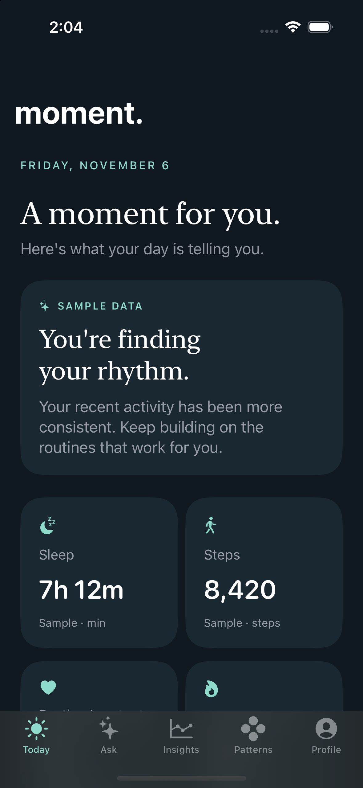
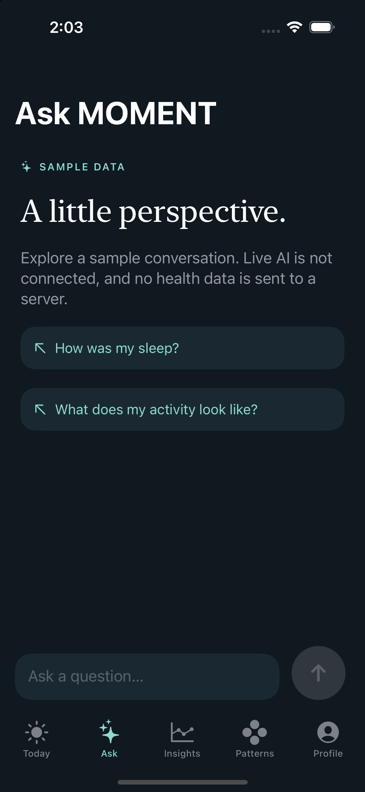
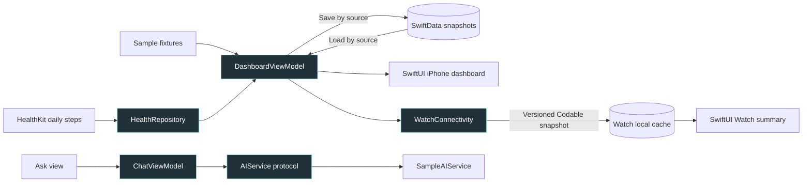

<div align="center">

# moment.

### Make sense of your day.

**A quieter dashboard. A glance on your wrist. A native foundation for personal wellbeing.**

Built with SwiftUI for iPhone and Apple Watch.<br>
Midnight surfaces, soft mint accents, and an experience that starts on your devices.

<p>
  
  
  
  
</p>
<p>
  <a href="https://github.com/Skeeb32/machine-learning-watch-ios/stargazers"></a>
  <a href="https://github.com/Skeeb32/machine-learning-watch-ios/forks"></a>
  <a href="https://github.com/Skeeb32/machine-learning-watch-ios/commits/main/"></a>
</p>

[Explore the app](#the-midnight-experience) · [Run locally](#quick-start) · [Explore the engineering](#under-the-surface) · [Contribute](#build-the-next-moment)

</div>

> **Build 0.1 · Native foundation** — A runnable iPhone app and a compile-verified Watch companion. Daily steps have a real HealthKit query; charts, insight examples, and chat use explicitly labeled samples. Live AI and machine learning are roadmap work.

---

## The Midnight experience

<table>
  <tr>
    <th align="center">Your day, at a glance</th>
    <th align="center">A little perspective</th>
  </tr>
  <tr>
    <td align="center"></td>
    <td align="center"></td>
  </tr>
  <tr>
    <td align="center">Reusable cards · Visible data sources · Daily summary</td>
    <td align="center">Suggested prompts · Typed questions · Mock responses</td>
  </tr>
</table>

<p align="center"><sub>Actual iPhone 15 Pro simulator captures from Build 0.1. All health values shown are illustrative.</sub></p>

### Five places to explore

| Destination | What you can do today |
| --- | --- |
| ☀️ **Today** | Explore metric cards and a daily reflection; pull to refresh; distinguish samples, missing values, and cached summaries. |
| ✨ **Ask** | Choose a suggested question or type your own. A dedicated mock service returns clearly labeled sample responses. |
| 📊 **Insights** | Switch between 7-day and 30-day sample activity charts, with a daily average. Live mode explains that history is not connected. |
| 🌀 **Patterns** | Preview how observations could be presented, with an explicit explanation that personal pattern detection is still planned. |
| ⚙️ **Profile** | Switch sample/live modes, toggle daily suggestions, connect step data, and inspect Watch connectivity status. |

**On your wrist:** a separate native Watch app includes a summary, activity card, insight detail, sample preview, and first-sync guidance. Quick prompts explain how to continue on iPhone; they do not send live AI requests.

## Why MOMENT exists

Health metrics are useful, but the experience around them matters: what was measured, when it was updated, and what is actually available should be easy to understand.

MOMENT explores a calmer way to present that information. The iPhone holds the fuller experience; the Watch keeps the latest summary close. The long-term direction is grounded personal intelligence. This repository establishes the native interface and data boundaries that direction needs.

Three principles shape the current implementation:

- **Useful without a server.** Explore the app, change preferences, and read saved summaries without configuring a backend.
- **Show where data comes from.** Sample and HealthKit snapshots stay separate. Missing measurements display as `—`.
- **Build clear integration boundaries.** Views use view models and services; HealthKit, persistence, and chat each have replaceable interfaces.

## Under the surface

### Native stack, shared foundations

| Layer | Implementation | Why it matters |
| --- | --- | --- |
| iPhone + Watch UI | SwiftUI, system typography, shared Midnight components | Platform-native navigation with a consistent visual language |
| Visualization | Swift Charts | Native bar charts for the sample activity history |
| State | `ObservableObject`, Combine, `@MainActor`, async/await | Explicit UI state and asynchronous service boundaries |
| Local persistence | SwiftData on iPhone; UserDefaults for preferences and Watch cache | Saved summaries and preferences without a backend dependency |
| Health integration | HealthKit | On-demand, read-only daily step authorization and aggregation |
| Device communication | WatchConnectivity | Versioned latest-state snapshots using `updateApplicationContext` |
| Shared code | Local Swift package, `MomentShared` | Codable models, fixtures, styling, and connectivity shared across targets |
| Project + verification | XcodeGen, Xcode, XCTest, XCUITest | Checked-in project generation input and reproducible local checks |

**No third-party package dependencies. No API keys. No backend setup for Build 0.1.**

### How a summary reaches your wrist



The diagram describes the implemented paths. Watch delivery is scheduled by the operating system; paired-device transfer still needs validation. There is no remote AI path in this build.

### Engineering decisions worth exploring

| Challenge | Current approach | Read the code |
| --- | --- | --- |
| Keep demo values out of live mode | Source-specific cache records; clear displayed data before switching sources | [DashboardViewModel](Moment/Features/DashboardViewModel.swift) · [SnapshotStore](Moment/Data/SnapshotStore.swift) |
| Represent incomplete health data | Optional measurements; empty read results remain unavailable | [HealthKitManager](Moment/Services/HealthKitManager.swift) |
| Avoid stale Watch updates | Check payload version and timestamp before replacing the local snapshot | [Models](MomentShared/Sources/MomentShared/Models.swift) · [ConnectivityManager](MomentShared/Sources/MomentShared/Connectivity.swift) |
| Keep UI independent of AI providers | An injected `AIService` interface and a labeled sample implementation | [AIService](Moment/Services/AIService.swift) |
| Make behavior testable | Inject storage, health repository, preferences, and clock; use an in-memory persistence test | [Unit tests](MomentTests/MomentTests.swift) |

<details>
<summary><strong>Repository map</strong></summary>

```text
Moment.xcodeproj/          Checked-in project and shared schemes
project.yml               XcodeGen source of truth
Moment/
  App/                    App entry point, onboarding, tab navigation
  Features/               Screens and dashboard view model
  Data/                   SwiftData snapshot store
  Services/               HealthKit repository and sample AI service
MomentWatch/              Watch entry point, summary, details, prompts
MomentShared/             Local Swift package
  Sources/MomentShared/   Models, fixtures, design, connectivity
MomentTests/              Behavioral unit tests
MomentUITests/            Onboarding, navigation, sample-chat smoke test
docs/                     Screenshots, validation, backend roadmap
```

</details>

## Quick start

### 1. Check your environment

- A **Mac with Xcode**, including iOS and watchOS SDK support. The recorded build used **Xcode 27.1**; other Xcode versions have not been verified.
- An installed iPhone simulator runtime. The recorded UI tests used **iOS 17.5**.
- A watchOS simulator runtime if you want to **launch** the Watch app.
- Git. **XcodeGen is optional** unless you change the project configuration.

Deployment targets are iOS 17 and watchOS 10. The local package uses Swift tools version 5.9; the project selects Swift 5 language mode.

### 2. Clone and open

```sh
git clone https://github.com/Skeeb32/machine-learning-watch-ios.git
cd machine-learning-watch-ios
open Moment.xcodeproj
```

There is no `.env` file to create, no package server to configure, and no service to start. Xcode resolves `MomentShared` from this repository.

### 3. Run on iPhone

1. Select the **Moment** scheme.
2. Choose an installed **iPhone simulator** as the destination.
3. Press **⌘R**.
4. Tap **Explore MOMENT** to enter sample mode.

**Try this short tour:** open Today → select a period in Insights → try “How was my sleep?” in Ask → change the daily-suggestion preference in Profile.

To exercise the live step path, choose **Profile → Connect Apple Health**. Only steps are requested in this milestone. Sleep, resting heart rate, and active energy remain unavailable in live mode. Ask continues to use sample responses in either mode.

### 4. Run on Apple Watch

1. Install a watchOS simulator runtime through **Xcode → Settings → Components** if needed.
2. Create a Watch simulator and pair it with a compatible iPhone simulator.
3. Select **MomentWatch**, choose the Watch destination, and press **⌘R**.
4. Open MOMENT on iPhone and refresh Today to queue a summary. You can also enable **Preview sample** on the Watch.

A Watch with no saved summary shows first-sync guidance. A previously received summary is cached locally for offline viewing.

<details>
<summary><strong>Physical devices and signing</strong></summary>

Choose your development team under Signing & Capabilities for **both** app targets. Use bundle identifiers available to your team and preserve the companion relationship:

- iPhone default: `com.skeeb32.moment`
- Watch default: `com.skeeb32.moment.watchkitapp`
- Watch companion identifier: the iPhone app's bundle identifier

Keep the HealthKit capability enabled for the iPhone target. Make durable identifier/configuration changes in `project.yml` and regenerate the project. Do not commit personal signing credentials.

Physical-device HealthKit permissions and paired Watch delivery have not yet been verified. There is no TestFlight build or published release to install.

</details>

### 5. Build and test from the terminal

Run from the repository root:

```sh
# Check the active Xcode installation and available simulators.
xcodebuild -version
xcrun simctl list devices available

# Compile the iPhone app and embedded Watch companion.
xcodebuild -project Moment.xcodeproj -scheme Moment \
  -destination 'generic/platform=iOS Simulator' \
  CODE_SIGNING_ALLOWED=NO build

# Compile the Watch target independently.
xcodebuild -project Moment.xcodeproj -scheme MomentWatch \
  -destination 'generic/platform=watchOS Simulator' \
  CODE_SIGNING_ALLOWED=NO build

# Use a simulator UUID from the list above.
SIMULATOR_ID="YOUR_IPHONE_SIMULATOR_UUID"
xcodebuild -project Moment.xcodeproj -scheme Moment \
  -destination "platform=iOS Simulator,id=$SIMULATOR_ID" \
  CODE_SIGNING_ALLOWED=NO test
```

Do not add a global `-sdk iphonesimulator` override to the iPhone build: the embedded Watch app needs its own platform SDK.

If you edit target settings or add source files, install XcodeGen if needed, run `xcodegen generate`, and commit both `project.yml` and the generated project changes. Ordinary builds do not require regeneration.

## Evidence, not inflated numbers

The badges above report live GitHub activity. The table below records **local validation on November 6, 2026**, not a hosted CI guarantee.

| Signal | Recorded result |
| --- | --- |
| Application targets | **2** — iPhone and Apple Watch |
| Third-party package dependencies | **0** — one local shared package |
| Unit tests | **5 passed**, zero failures |
| UI smoke test | **1 test passed on 2 iPhone simulators** — iPhone 15 Pro and iPhone SE (3rd generation), iOS 17.5 |
| Watch simulator compilation | Passed for arm64 and x86_64 |
| Screenshots inspected | Today and Ask on iPhone 15 Pro |

[Read the validation record](docs/VALIDATION.md) · [View contributors](https://github.com/Skeeb32/machine-learning-watch-ios/graphs/contributors) · [Browse commit history](https://github.com/Skeeb32/machine-learning-watch-ios/commits/main/)

**Current gaps:** no GitHub Actions workflow, published coverage report, benchmark suite, or GitHub release. Watch runtime behavior, physical-device HealthKit, VoiceOver traversal, and the largest accessibility text sizes still need verification. Version **0.1.0** is the configured app version, not a release badge.

## Data and privacy behavior

- **Explicit provenance:** sample values carry labels and are stored separately from HealthKit snapshots.
- **Missing is not zero:** unavailable measurements render as `—`; live mode never silently fills them with fixtures.
- **Contextual permission:** Apple Health access is requested through the connection button. The app does not infer individual read authorization from request completion.
- **Visible freshness:** summaries include their update time. Snapshots older than one hour are labeled cached.
- **Local processing in this milestone:** no account service, analytics SDK, or AI server is connected. Chat lives in memory and clears when the process exits.

<details>
<summary><strong>Cache lifecycle and current boundaries</strong></summary>

SwiftData stores one versioned snapshot per source on iPhone. The Watch maintains a separate UserDefaults cache. A failed refresh can retain an already loaded summary; refresh errors and timestamps remain visible. Mode changes clear the displayed snapshot before fetching the new source.

Daily steps use the device calendar's start of day through the query time. Refresh after a date/timezone change. Historical aggregation, sleep overlap handling, and robust background refresh are future work.

The app does not configure cloud synchronization. Removing the iPhone app removes its local store; remove the Watch app separately to remove its cache. Account-wide deletion is not implemented because there are no accounts. Future persistent schema changes need an explicit migration plan.

</details>

## Where MOMENT goes next

| Stage | Status | Scope |
| --- | --- | --- |
| **01 · Midnight foundation** | ✅ Implemented | Five iPhone destinations, onboarding, design primitives, sample charts and chat |
| **02 · Native data foundation** | ✅ Implemented; device validation pending | Separate app targets, shared package, persistence, daily-step query, Watch snapshot transfer |
| **03 · Apple ecosystem** | ◻ Next | Validate paired devices; expand health queries; accessibility checks; complications and notifications |
| **04 · Personal intelligence** | ◻ Planned | Authenticated backend, personal baselines, retrieval, and grounded conversations |
| **05 · Release preparation** | ◻ Planned | Account lifecycle, StoreKit 2, production icons, privacy review, TestFlight and App Store preparation |

The [backend roadmap](docs/BACKEND.md) proposes FastAPI, PostgreSQL, OpenAI, Pinecone, and orchestration/retrieval tooling. **Those technologies are not implemented or dependencies of this app.** The [master build brief](MOMENT_MASTER_PROMPT.md) records the wider product direction.

## For engineers and hiring teams

This repository demonstrates how a native prototype can grow through explicit contracts and testable behavior. A useful review starts with four areas:

1. **Cross-device design:** two independent SwiftUI entry points share a local package while maintaining separate persistence and lifecycle behavior.
2. **State correctness:** source-aware caching, nullable measurements, version checks, and timestamp ordering handle cases that a happy-path dashboard can hide.
3. **Apple platform integration:** a HealthKit statistics query bridges into async/await; WatchConnectivity delegates hand state back to the main actor.
4. **Verification:** behavioral tests cover persistence updates, sample/live separation, failed refreshes, and chat submission; a UI test exercises onboarding and navigation on two screen sizes.

Start with [DashboardViewModel](Moment/Features/DashboardViewModel.swift), follow the [shared snapshot contract](MomentShared/Sources/MomentShared/Models.swift), then inspect the [tests](MomentTests/MomentTests.swift). This is an early engineering build with documented limits, not a claim of production scale or deployed machine learning.

## Build the next MOMENT

Bug reports, accessibility feedback, and focused pull requests are welcome. Useful starting points include paired Watch testing, clearer unavailable-data states, additional HealthKit queries with tests, and a macOS CI workflow.

1. [Open an issue](https://github.com/Skeeb32/machine-learning-watch-ios/issues/new) for a substantial change so the scope is clear.
2. Fork the repository, clone your fork, and follow the quick start above.
3. Create a branch: `git switch -c feat/your-change`.
4. Keep sample data visibly labeled, preserve source separation, and keep service logic out of views.
5. Add meaningful tests for changed behavior. Run the relevant scheme and tests; regenerate the project when its inputs change.
6. Submit a PR describing the problem, implementation, validation, and remaining limitations. Include simulator screenshots for UI changes and the device/OS versions used.

Never include health records, API keys, or signing credentials in issues or commits. The repository currently has **no LICENSE file**; no open-source license grant is asserted here. Contact the maintainer about reuse terms.

---

<div align="center">

### A small moment. A thoughtful foundation.

If this approach resonates, **⭐ star the repository** to follow its progress.<br>
Fork it to experiment, share it with an iOS developer, or help shape the next milestone.

[⭐ Star on GitHub](https://github.com/Skeeb32/machine-learning-watch-ios) · [🍴 Fork the project](https://github.com/Skeeb32/machine-learning-watch-ios/fork) · [💡 Suggest an improvement](https://github.com/Skeeb32/machine-learning-watch-ios/issues/new)

<sub>MOMENT · Midnight Edition · Built for iPhone and Apple Watch</sub>

</div>
