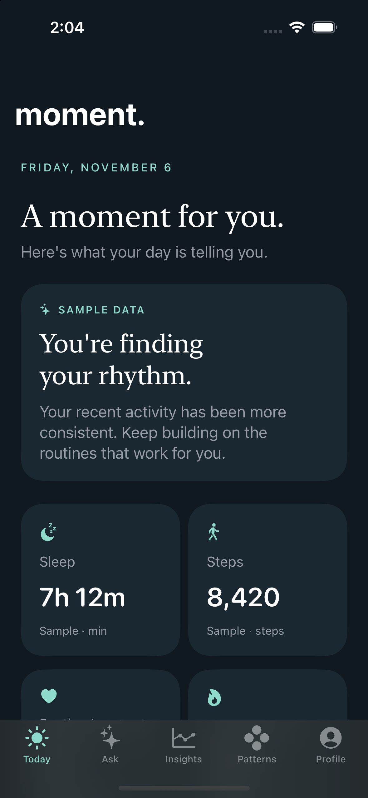

# Build 0.1 validation

Validated November 6, 2026 with Xcode 27.1 (27A9275).

| Check | Result |
| --- | --- |
| Watch simulator build | Passed for generic watchOS Simulator, arm64 and x86_64 |
| iPhone build and launch | Passed on iPhone 15 Pro, iOS 17.5 |
| Unit tests | 5 passed, 0 failures |
| iPhone 15 Pro UI test | Passed: onboarding, five tabs, sample chat, return to Today |
| iPhone SE (3rd generation) UI test | Same flow passed on iOS 17.5 |
| Visual inspection | Today and Ask screenshots inspected on iPhone 15 Pro |

Commands executed from the repository (derived-data paths abbreviated):

```sh
xcodebuild -project Moment.xcodeproj -scheme MomentWatch \
  -sdk watchsimulator -destination 'generic/platform=watchOS Simulator' \
  -derivedDataPath /path/to/work/WatchDerivedData CODE_SIGNING_ALLOWED=NO build
xcodebuild -project Moment.xcodeproj -scheme Moment \
  -destination 'platform=iOS Simulator,id=8345B81A-996F-4745-B754-9CA04E783B7D' \
  -derivedDataPath /path/to/work/DerivedData CODE_SIGNING_ALLOWED=NO test
xcodebuild -project Moment.xcodeproj -scheme Moment \
  -destination 'platform=iOS Simulator,id=4E797AFC-F3C6-4608-86B0-8BC49F1B8017' \
  -derivedDataPath /path/to/work/DerivedData -only-testing:MomentUITests \
  CODE_SIGNING_ALLOWED=NO test
```

Tests exercise serialization/version rejection, stale update ordering, missing versus zero values, persistence updates and source isolation, failed live-mode switching, empty chat submission, labeled mock responses, and core navigation. The second device reruns the UI smoke test to check the smaller layout.

The first iPhone build exposed a global SDK override affecting the embedded Watch target and actor-isolated default initializers. Both were corrected before the passing test runs.

Xcode emitted an App Intents metadata warning because these targets do not implement App Intents, and SDK-record diagnostic messages during testing. The test command still exited successfully.

## Not yet verified

- Watch launch/layout on a simulator or device: no watchOS simulator runtime was installed.
- Actual paired Watch delivery, reconnect behavior, and background transfer.
- Authorized, restricted, or revoked HealthKit records on physical devices.
- VoiceOver traversal and the largest accessibility text sizes.
- Signing, archive/distribution, App Store icons, TestFlight, and release readiness.
- Live AI/backend, historical metrics, notifications, complications, and subscriptions: intentionally not implemented.

The Watch's successful compilation does not establish paired-device behavior. Simulator sample data is not a real health measurement.


